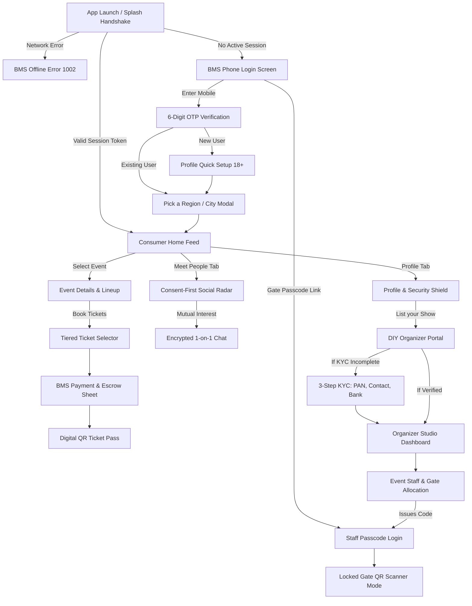

# Milo App — Complete Product Requirements Document (PRD v3.0 Master Blueprint)
### Tagline: *Milna Aasaan. Pal Yaadgaar. Data Aapka.*
### Architecture: BookMyShow SP++ (Social Discovery + Hyperlocal Events + Gate Ticketing + Multi-Role Operations)

---

## 1. Executive Summary & Product Vision

### 1.1 Product Identity
* **App Name:** Milo
* **Platforms:** Flutter Native (Android primary target SDK 34, iOS ready) + Responsive Web Portals (Organizer Studio & Super Admin Console).
* **Core Value Proposition:** 
  BookMyShow-grade high-frequency ticketing + Consent-driven Hyperlocal Social Discovery + Granular Privacy Shield + Multi-tenant Event Management (DIY Organizer KYC & Locked Gate Security).

### 1.2 The Core Problem & Differentiator
Traditional ticketing platforms (BookMyShow, Paytm Insider) treat events as isolated transactions—attendees buy passes, attend, and leave as strangers without community retention. Conversely, social networking apps (Instagram, Bumble BFF) lack verified local ticketed event contexts. 

Milo unifies both worlds:
1. **Verified Ticketed Gatherings:** Dandiya Nights, Garba Festivals, College Fests, DJ Parties, Standup Comedy, Live Concerts, and Workshops.
2. **Consent-Driven Social Radar:** Attendees can opt-in to discover and chat with fellow attendees without revealing phone numbers, emails, or exact coordinates.
3. **Enterprise Multi-Role Hierarchy:** Frictionless, secure segregation of Customers, Organizers, Gate Scanners, Promoters, and Admins.

---

## 2. User Roles & Permission Matrix (Zero Role Confusion)

| Role | Identity & Auth Anchor | Entry Point | Operational Scope | Hard Security Boundaries |
|---|---|---|---|---|
| **Customer (User/Attendee)** | Mobile Number + 6-digit SMS OTP | BMS Phone Login Screen | Browse cities, book passes, radar social discovery, private messaging, emergency safety shield. | Cannot access organizer financial dashboards; cannot validate gate tickets. |
| **Organizer (Host)** | Verified Business PAN + Bank IFSC via DIY Portal | Profile Screen ➔ **"List your Show"** | Create events, tiered tickets, view live gross sales, invite gate staff, request escrow settlements. | Requires approved 3-step KYC; cannot bypass platform escrow policies. |
| **Gate Staff (Scanner Guard)** | Mobile No. + 6-digit Event Passcode (e.g., `GATE-892182`) | Login Screen ➔ **"Login as Gate Staff (Passcode)"** | Fast camera QR scanner, attendee check-in, duplicate prevention, admission count. | **Locked Mode:** Cannot view event revenues, ticket prices, user chat, or personal customer profiles. |
| **Promoter (Influencer)** | Mobile Number + Referral Code Link | Profile ➔ "Promoter & Influencer Hub" | Generate trackable affiliate links, real-time commission ledger, payout history. | Read-only referral stats; no admin or gate controls. |
| **Super Admin** | 2FA Enterprise Credentials | Web Management Console (`/admin`) | KYC approvals, fraud detection, disputes/refunds, payout disbursement, content moderation. | Full platform administrative oversight. |

---

## 3. Screen-by-Screen User Journey (App Launch Se End Tak)

---

### 3.1 App Launch & Consumer Onboarding Flow

#### Screen 1: Milo Animated Splash Screen (`splash_screen.dart`)
* **Components:** Animated brand badge, pulse ring glow, continuous shimmer reflection, app version check.
* **Logic:** Pre-flight network check. Validates cached JWT session (`FlutterSecureStorage`). If valid, routes directly to role router; otherwise proceeds to BMS Phone Login.

#### Screen 2: BMS Phone Login Screen (`bms_phone_login_screen.dart`)
* **Reference:** BookMyShow Screen 1.
* **Header:** Milo Live Logo + top-right `Skip` button (direct guest browsing).
* **Hero Visual:** 3D Isometric Venue Map card (*"Discover venues and mark them as favourites"*).
* **Input Block:** Indian Flag dropdown (+91) with 10-digit mobile number textfield.
* **Primary CTA:** BMS Crimson Red (`#E11D48`) `Login with OTP` button.
* **Alternate Access:** Single-tap Google Sign-in, Envelope Mail link, and `Login as Gate Staff (Passcode)`.
* **Legal Footer:** Clickable links to Terms & Conditions and Privacy Policy.

#### Screen 3: 6-Digit OTP Verification Screen (`bms_otp_verification_screen.dart`)
* **Reference:** BookMyShow Screen 2.
* **Hero Visual:** 3D Popcorn, Tickets, Bell, and Credit Card graphics (*"Get updates on upcoming movies and events you like"*).
* **Components:** Back link, destination prompt (`Enter OTP sent to +91 XXXXX XXXXX`).
* **Input Array:** 6 auto-advancing, rounded numeric input boxes with active crimson borders.
* **Timer:** Live 25-second countdown timer (`Resend OTP in 25 seconds` ➔ `Resend OTP`).
* **Action:** Full-width `Submit` button with loading spinner.

#### Screen 4: Region / City Selection Sheet (`bms_pick_region_sheet.dart`)
* **Reference:** BookMyShow Screen 3.
* **Search Bar:** Real-time city search with clear icon.
* **Location Permission Trigger:** `Auto Detect My Location`.
* **Permission Disclosure Modal ("Hey there! Where are you?"):**
  * Friendly explorer illustration.
  * Explains that location data is collected only while using the app to recommend events, send alerts, and curate nearby feeds.
  * Actions: `Detect My Location` (GPS trigger) and `Select Manually`.
* **Popular Cities Grid:** Circular icon cards for Lucknow, Mumbai, Delhi-NCR, Bengaluru, Hyderabad, Ahmedabad, Pune, Kolkata, Jaipur, Chandigarh.
* **All Cities List:** Alphabetical indexed list across 50+ Indian cities.

#### Screen 5: Consumer Profile Quick Setup (`profile_setup_screen.dart`)
* **Trigger:** Triggered for first-time sign-ups.
* **Inputs:** Display Name, Age / DOB confirmation (18+ compliance gatekeeper), Gender preference, City preference, and optional Avatar upload.

---

### 3.2 Discovery, Event Management & Social Radar

#### Screen 6: BMS-Grade Consumer Home Feed (`home_screen.dart`)
* **Top App Bar:**
  * Milo App Logo with live pulse dot.
  * Current City Selector with location pin (e.g., `Lucknow, India ▾`).
  * Search icon + Notification bell + Profile avatar.
* **Category Pills:** All, Dandiya & Garba 🪘, DJ Nights 🎧, Live Music 🎸, Standup Comedy 🎤, College Fests 🎓, Kitty & Brunch 💅.
* **Hero Carousel:** Auto-scrolling banner spotlighting major events and festival nights.
* **Content Rails:**
  * *Events Happening This Weekend:* Date, venue, ticket starting price, verified organizer badge.
  * *Milo Social Radar (Meet Attendees):* Opt-in attendee cards attending similar shows.
  * *Create Beacon Pin:* Quick meetup creator for concert squads.
* **Bottom Navigation:** Home | Explore | My Tickets | Chat / Radar | Profile.

#### Screen 7: Event Details & Booking Journey (`event_details_screen.dart`)
* **Header:** Hero poster carousel, back button, share deep link (`milo://m/EVENT_ID`), wishlist toggle.
* **Metadata:** Event title, organizer verified tick, date/time chip, complete venue address with Google Maps preview.
* **Information Tabs:** Event description, artist lineup, entry rules, age policies, refund terms.
* **Tiered Ticket Selection:**
  * Single Entry (General / Female / Male).
  * Couple VIP Pass.
  * VIP Table / Lounge Packages.
  * Season Multi-Day Passes.
* **BMS Payment Sheet (`milo_bms_payment_sheet.dart`):**
  * Ticket breakdown + Platform fee (5%) + GST.
  * Promo / Influencer Referral code discount box.
  * Gateways: UPI (GPay, PhonePe, Paytm), Net Banking, Cards, and Escrow-protected Self Gateway.

#### Screen 8: Digital Ticket & Check-in Pass (`my_tickets_screen.dart`)
* **Features:** Active & Past bookings tabs, High-contrast encrypted dynamic QR code, Booking Reference ID (e.g., `MILO-892182`), Venue instructions, Download PDF ticket option.

#### Screen 9: Consent-First Social Radar & Chat (`meet_people_screen.dart` & `chat_conversation_screen.dart`)
* **Features:**
  * Profile visibility controls (Ghost Mode / Incognito Event Attendance).
  * Interest-based matching badges (Music, Dance, Networking, Tech).
  * Connection requests (requires mutual consent before messaging unlocks).
  * End-to-end encrypted 1-on-1 and Event Community Group chats.

---

### 3.3 Profile, Safety Shield & Organizer Entry

#### Screen 10: Profile & Security Hub (`profile_safety_screen.dart`)
* **Profile Header:** Avatar, Display Name, Phone Number, Face-Verified badge.
* **Emergency Safety Shield (Milo Exclusive):**
  * **Simulate Fake Call 📞:** Instant simulated incoming phone call with ringtone to excuse users safely from uncomfortable gatherings.
  * **Instant SOS 🚨:** One-tap emergency broadcast dispatching live GPS coordinates to 2 emergency contacts and the venue security desk.
* **Privacy Shield Controls:**
  * Ghost Mode (Pause radar visibility).
  * Incognito Event Attendance (Never display user on public attendee lists).
  * Mutual Interest Requests Only.
* **Navigation Rails:**
  * **"List your Show 🎪":** Direct gateway to BMS DIY Organizer Portal.
  * **"Influencer & Promoter Hub 🚀":** Affiliate commission tracking.
  * Bank & Payout Settings, Ticket History, Help Centre, Terms, and Privacy Policy.

---

### 3.4 Do-It-Yourself (DIY) Organizer Portal & 3-Step KYC

#### Screen 11: DIY Event Management Landing Page (`bms_list_your_show_portal_screen.dart`)
* **Reference:** BookMyShow Screens 4 & 5.
* **Branding:** Royal Navy (`#1E293B`) & BMS Crimson enterprise theme.
* **Headline:** *"Benefits of using Do It Yourself our new event management tool"*.
* **Benefit Highlights:**
  1. *Quick & easy registration:* Complete setup using PAN card and bank details.
  2. *Take events live superfast:* Publish shows within 15 minutes.
  3. *Monitor analytics & insights:* Track sales, daily ticketing, and real-time velocity.
  4. *Add & delegate gate staff:* Issue 6-digit access passcodes for gate scanners.
* **Primary Action:** `Get Started with DIY Portal →` (or `Go to Organizer Dashboard` if already verified).

#### Screen 12: Step 1 of 3 — Organisation & Legal Details (`bms_do_it_yourself_screen.dart`)
* **Reference:** BookMyShow Screen 6.
* **Progress Bar:** `Step 1 of 3 [====      ]`.
* **Inputs:**
  * Organisation/Individual PAN Card Number (auto-uppercase with regex check).
  * Organisation/Individual Registered Name (auto-populated from PAN lookup).
  * Organisation/Individual Registered Business Address.
  * Radio Group: *"Whether your PAN is linked with Aadhaar? [Yes / No / NA]"*.
* **Actions:** `Save details` (draft state) | `Proceed →`.

#### Screen 13: Step 2 of 3 — Contact Person Details (`bms_do_it_yourself_screen.dart`)
* **Reference:** BookMyShow Screen 7.
* **Progress Bar:** `Step 2 of 3 [========  ]`.
* **Inputs:**
  * Full Name of primary POC.
  * Official Business Email Address.
  * Mobile Number (read-only, auto-filled from verified authentication session).
* **Actions:** `Save details` | `Proceed →`.

#### Screen 14: Step 3 of 3 — Bank Details & Settlement (`bms_do_it_yourself_screen.dart`)
* **Reference:** BookMyShow Screen 7.
* **Progress Bar:** `Step 3 of 3 [==========]`.
* **Inputs:**
  * Beneficiary Bank Account Number (masked input).
  * Confirm Bank Account Number.
  * Bank IFSC Code (11 alphanumeric characters).
* **Validation Action:** `Verify Bank Details` button (Penny-Drop verification with bank name & branch retrieval).
* **Escrow Agreement:** Acknowledgement of 5% platform fee and automated T+1 post-event settlement.
* **Action:** `Complete Setup 🚀` ➔ Promotes account to `MiloRole.organizer` and navigates to Organizer Studio.

---

### 3.5 Organizer Event Management & Gate Delegation

#### Screen 15: Organizer Studio Dashboard (`organizer_dashboard_screen.dart`)
* **Real-time Analytics:** Total Revenue (₹), Tickets Sold / Capacity, Checked-in attendee count.
* **Management Controls:** Create Event wizard, Edit ticket tiers, Sales reports, Gate staff delegation.

#### Screen 16: Event Staff Allocation Modal (`manage_staff_roles_screen.dart`)
* **Fields:** Staff Name, Staff Phone Number, Event Assignment dropdown, Assigned Gate (e.g., *Gate 1 - Main Entrance*, *Gate 2 - VIP / Couple Fast-Track*, *Lounge Desk*), Role permissions.
* **Passcode Engine:** System generates a secure 6-digit credential (e.g., `GATE-892182`) with direct WhatsApp / SMS share link.

#### Screen 17: Staff Locked Scanner Mode (`qr_scanner_screen.dart`)
* **Header:** `Gate Security & Check-in 🎟️` with locked green indicator `🔒 Staff Mode Locked • Gate 1`.
* **Security Guardrails:**
  * Scanner is hardware-bound to the assigned event.
  * **Status Responses:**
    * `ENTRY APPROVED ✅` (Green beep + Attendee name & tier).
    * `ALREADY CHECKED IN ⚠️` (Amber alert + Duplicate ticket warning).
    * `WRONG EVENT TICKET 🚫` (Red rejection + event mismatch alert).
  * Staff cannot navigate back to customer feed or organizer financial figures.
  * `Exit Staff Mode` requires confirmation and performs secure session logout.

---

### 3.6 System Edge States

#### Screen 18: BMS Offline Error Screen (`milo_offline_screen.dart`)
* **Reference:** BookMyShow Screen 8.
* **Visual:** Isometric device frame with centered caution triangle.
* **Copy:** *"Are you offline? Your internet might be unstable. Please try again. (Error code: 1002)"*.
* **Actions:** `Try Again` (retries network ping) and `Continue in Offline Demo Mode →`.

---

## 4. Technical Specifications & Security Architecture

### 4.1 Mobile Stack
* **Framework:** Flutter SDK 3.16+ (Dart).
* **Application ID / Package:** `app.milo.live` (Clean Release Keystore signed).
* **Typography:** Google Fonts (`Inter` across all headings and tables).
* **Hardware Drivers:** `mobile_scanner` (Camera QR scanner), `flutter_secure_storage` (Hardware encrypted keychain/keystore), `geolocator` (City detection).

### 4.2 Backend & Data Layer
* **API Service:** Node.js + Express REST API (`server.js`).
* **Relational Database:** PostgreSQL (Neon Serverless via `pg`) + Firebase Firestore (`cloud_firestore`) for real-time ticket check-in logs and chat streams.
* **Authentication:** Firebase Phone Auth (`firebase_auth`) with auto-retrieval SMS verification + local secure session fallbacks.
* **Payments & Escrow:** Razorpay / UPI Deep links + Self-hosted Escrow Settlement Gateway.

### 4.3 Security & Anti-Fraud Mechanisms
1. **Dynamic QR Cryptography:** Every ticket QR code contains an HMAC-SHA256 signature combining `booking_id + user_id + salt + timestamp`. Screen recording or static screenshots are blocked via rotating watermarks.
2. **Atomic Gate Check-in:** Once scanned at Gate 1, Firestore triggers an immediate atomic document lock; secondary scans trigger an instant audible buzzer and `ALREADY CHECKED IN` alert.
3. **Escrow Safeguard:** Organizer payouts are settled T+1 after successful event completion, protecting attendees against fraudulent or cancelled events.

---

## 5. Implementation Verification & Deliverables

| Module / Screen | Implementation File | Verification Status |
|---|---|---|
| **BMS Phone Login Screen** | `lib/screens/auth/bms_phone_login_screen.dart` | Verified & Tested |
| **BMS 6-Digit OTP Verification** | `lib/screens/auth/bms_otp_verification_screen.dart` | Verified & Tested |
| **Pick a Region & Location Consent** | `lib/widgets/bms_pick_region_sheet.dart` | Verified & Tested |
| **BMS Offline Error (1002)** | `lib/screens/milo_offline_screen.dart` | Verified & Tested |
| **DIY Organizer Portal Landing** | `lib/screens/organizer/bms_list_your_show_portal_screen.dart` | Verified & Tested |
| **3-Step Organizer KYC Setup** | `lib/screens/organizer/bms_do_it_yourself_screen.dart` | Verified & Tested |
| **Gate Staff Passcode Login** | `lib/screens/auth/staff_login_screen.dart` | Verified & Tested |
| **Locked Staff QR Scanner Mode** | `lib/screens/organizer/qr_scanner_screen.dart` | Verified & Tested |
| **Event Staff Role Management** | `lib/screens/organizer/manage_staff_roles_screen.dart` | Verified & Tested |
| **Safety Shield (Fake Call, SOS)** | `lib/screens/profile_safety_screen.dart` | Verified & Tested |
| **Android Release Binary (Fresh Package)** | `C:\Users\sahil\Downloads\milo-fresh-install.apk` | Build Successful (~72.9 MB) |
